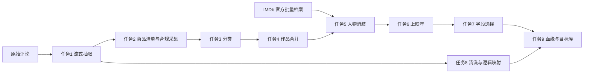

# Movie Reviews ETL

将 Stanford SNAP Amazon 电影评论与商品、作品和人物元数据整合为可重复运行、可恢复、可追溯的 ETL。实现采用 Python 参数化 DAG 与 SQLite 关系目标库，原始层、结构化层、集成层和目标层分开保存。

## 当前结果与验收状态

| 任务 | 实际结果 | 状态 |
| --- | --- | --- |
| 1 全量评论抽取 | 7,911,684 条评论；253,059 商品；889,176 用户 | 全量核验通过 |
| 2 合规采集 | 全量 ASIN 清单；公开研究元数据覆盖 73,813 商品；HTML 成功 0 | 受限替代路径，范围已披露 |
| 3 内容分类 | 全量有处理状态；电影商品 2,955；待确认 246,277 | 全量规则重放通过 |
| 4 作品合并 | 416 候选对；3 组多字段合并；2,953 条作品记录 | 工程核验通过；不足 5 组合并案例，人工评估待补 |
| 5 人物消歧 | 1,962 人物记录；2,392 条角色信用；120 对待标注 | 工程核验通过；实质别名与人工评估未达标 |
| 6 上映补全 | 169 条身份匹配后的上映年；完整日期 0 | 不伪造日期，缺失原因保留 |
| 7 字段选择 | 1,795,037 个选择状态，全部候选与理由保留 | 全量选择重放通过 |
| 8 评论清洗 | 原始评论全留；7,906,538 逻辑评论；精确重复映射 5,146 | 全量逐字段核验、幂等及恢复通过 |
| 9 血缘和目标库 | 全量目标库发布；7,742,034 条处理边；8 个查询执行通过 | 全量完整性、实际中断恢复与幂等检查通过 |

“作品记录”含临时单例，不是已确认的真实电影总数。同名/同年份/缺失年份不能单独支持合并；角色、商品版本和合集评论不混淆。两个 120 对队列均未人工标注，Precision/Recall/F1 为 NULL，不能把测试通过当作匹配准确率。最终验收不能宣称全部严格达标。

## 流程与模型



作业依赖、参数、失败阻断与日志由 [DAG 配置](config/pipeline.example.json) 管理；数据阶段用输入/规则指纹、事务检查点和唯一键恢复。字段血缘保存候选、原件定位、规则/运行、父子处理链及选用理由，不只有流程图。

## 运行

Python 3.11，Windows PowerShell；建议至少 8 GB 内存及 120 GB 可用磁盘，完整保留历史版本需更多空间。大文件和数据库不在 Git。

```powershell
python -m venv .venv
& .\.venv\Scripts\python.exe -m pip install -r requirements.txt
& .\.venv\Scripts\python.exe -m src.pipeline.run --plan
& .\.venv\Scripts\python.exe -m unittest discover -s tests/unit
```

首次重建：取得允许使用的原始文件，核对已登记的 SHA-256，调整 config 中的路径/版本目录，再登记本机输入并执行完整 DAG：

```powershell
& .\.venv\Scripts\python.exe src/extract/register_source.py --source data/raw/movies.txt --output data/staging/task1/full_v2/source_manifest.json --source-url https://snap.stanford.edu/data/movies.txt.gz
& .\.venv\Scripts\python.exe -m src.pipeline.run
```

已恢复登记来源、任务 1—4 与评论检查点时，可从集成步骤离线继续：

```powershell
& .\.venv\Scripts\python.exe -m src.pipeline.run --from-job task5 --offline
& .\.venv\Scripts\python.exe -m src.quality.run_queries --show-rows
```

只查看一类结果时，可用 `--query 6 --field-name title --show-rows`；还可传入 `--movie-id` 定位指定作品的字段血缘。完整评分聚合需扫描全量评论，运行时间长于字段查询。

中断后重跑同一命令；输入或规则变更时使用新版本目录，保留旧原件和决定。新解析 run_id 可改变 Parquet 二进制哈希，应重新导出当前分片清单，不沿用旧机清单。原始档案刷新后不保证能从公开地址恢复完全相同的历史字节。

固定离线样本先在已恢复来源的机器导出，之后不访问网络：

```powershell
& .\.venv\Scripts\python.exe -m src.quality.offline_acceptance export
& .\.venv\Scripts\python.exe -m src.quality.offline_acceptance run
```

## 交付材料

- [正式项目报告](reports/项目报告.md)：问题、来源、九项任务、核验、复现与未满足项。
- [统一实施记录](项目实施记录.md)：各任务方法、版本修正、实测结果、限制与 Git 上传记录。
- [ER 模型](docs/schema.mmd)、[演示及血缘 SQL](sql/demo_queries.sql)、[目标库视图](sql/target_views.sql)。
- reports/task1—task9：全量统计、检查、幂等/恢复和来源证据；reports/final：数据字典、完整性、离线复现及严格要求审计。
- data/raw、staging、integration、target：仅本机保存，具体位置、大小与哈希见统计/清单；克隆仓库不会得到数据本体。

## 来源与使用边界

[Stanford SNAP](https://snap.stanford.edu/data/web-Movies.html)、[UCSD Amazon 研究元数据](https://cseweb.ucsd.edu/~jmcauley/datasets/amazon_v2/)、[IMDb 官方批量数据](https://data.imdb.com/non-commercial-datasets/)。

IMDb 原始及派生数据仅用于本地个人非商业课程项目，不在公开 Git 重发布；来源限制见 [使用条件](https://help.imdb.com/article/imdb/general-information/can-i-use-imdb-data-in-my-software/G5JTRESSHJBBHTGX)。Information courtesy of IMDb (https://www.imdb.com). Used with permission.

AI 用于编程、检查和文档辅助，不充当电影事实来源或人工标注者。实际人工验收尚未完成的项目保持未完成状态。
