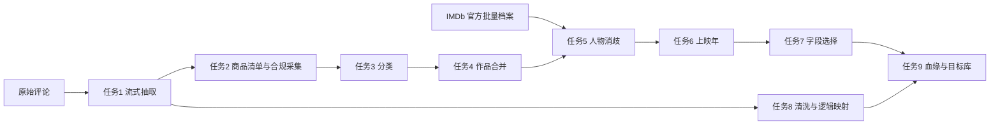

# Movie Reviews ETL

将 Stanford SNAP Amazon 电影评论与商品、作品和人物元数据整合为可重复运行、可恢复、可追溯的 ETL。实现采用 Python 参数化 DAG 与 SQLite 关系目标库，原始层、结构化层、集成层和目标层分开保存。

本版按用户指定范围封存：交付实现、报告、全量统计、工程验收及来源证据标注，不要求填写人工姓名或标注时间。来源标注不是独立人工金标准，原课程严格验收的差异仍如实保留。文件入口和打包方法见[最终交付说明](docs/最终交付说明.md)。

## 当前结果与验收状态

| 任务 | 实际结果 | 状态 |
| --- | --- | --- |
| 1 全量评论抽取 | 7,911,684 条评论；253,059 商品；889,176 用户 | 全量核验通过 |
| 2 合规采集 | 全量 ASIN 清单；公开研究元数据覆盖 73,813 商品；HTML 成功 0 | 受限替代路径，范围已披露 |
| 3 内容分类 | 全量有处理状态；电影商品 3,617；待确认 245,615 | 全量规则重放通过 |
| 4 作品合并 | 552 候选对；5 组多字段合并；3,613 条作品记录 | 五组合并及来源标注交付；非人工金标 |
| 5 人物消歧 | 3,245 人物记录；3,923 条角色信用；5 组实质别名 | 全量重放及来源标注交付；非人工金标 |
| 6 上映补全 | 282 条身份匹配后的上映年；完整日期 0 | 不伪造日期，缺失原因保留 |
| 7 字段选择 | 1,800,317 个元数据选择状态，全部候选与理由保留 | 全量选择重放通过 |
| 8 评论清洗 | 原始评论全留；7,906,538 逻辑评论；精确重复映射 5,146 | 全量逐字段核验、幂等及恢复通过 |
| 9 血缘和目标库 | final_v8 全量发布；7,876,297 条处理边；10 个查询执行通过 | 全量完整性与幂等、固定样本实际中断恢复通过 |

“作品记录”含临时单例，不是已确认的真实电影总数。同名/同年份/缺失年份不能单独支持合并；角色、商品版本和合集评论不混淆。两类各 120 对来源标注已经生成，共 187 对确定判断、53 对证据不足弃判；不填写人工身份字段。独立人工完成数仍为 0、独立准确率为 NULL；不能把来源重叠的一致性统计当作独立准确率，也不能声称原课程所有条件严格达标。

五组为 Star Trek VI、Lady for a Day、Chocolate、The Big Lebowski、The Other Boleyn Girl；新增两组经真实来源证据及 complete-link 检查后，由同一 DAG 重算下游，不直接编辑目标映射。[五组验收](reports/task4/five_group_acceptance.json)与[流水线验收](reports/final/movie_merge_pipeline_acceptance.json)记录实际结果。

2026-10-19 已实际复试 Scrapy 2.19.0；VPN 开启与关闭后 robots 预检均返回 HTTP 503，商品请求 0。[复试汇总](reports/task2/scrapy_retest_summary.json)保留证据位置及哈希。未满足真实 HTML 成功的替换条件，正式流程仍用原实现；未提升的试验代码和数据已移到项目外归档。

## 流程与模型



作业依赖、参数、失败阻断与日志由 [DAG 配置](config/pipeline.example.json) 管理；数据阶段用输入/规则指纹、事务检查点和唯一键恢复。字段血缘保存候选、原件定位、规则/运行、父子处理链及选用理由，不只有流程图。

## 运行

Python 3.11，Windows PowerShell；建议至少 8 GB 内存及 120 GB 可用磁盘，完整保留历史版本需更多空间。大文件和数据库不在 Git。

```powershell
python -m venv .venv
& .\.venv\Scripts\python.exe -m pip install -r requirements.txt
& .\.venv\Scripts\python.exe -m src.pipeline.run --plan
& .\.venv\Scripts\python.exe -m unittest discover -s tests/unit
```

首次重建：取得允许使用的原始文件，核对已登记的 SHA-256，调整 config 中的路径/版本目录，再登记本机输入并执行完整 DAG：

```powershell
& .\.venv\Scripts\python.exe src/extract/register_source.py --source data/raw/movies.txt --output data/staging/task1/full_v2/source_manifest.json --source-url https://snap.stanford.edu/data/movies.txt.gz
& .\.venv\Scripts\python.exe -m src.pipeline.run
```

已恢复任务 1—2、评论检查点及登记的 IMDb 原始档案时，可离线重算分类及全部受影响下游：

```powershell
& .\.venv\Scripts\python.exe -m src.pipeline.run --from-job task3 --offline
& .\.venv\Scripts\python.exe -m src.quality.run_queries --show-rows
```

只查看一类结果时，可用 `--query 6 --field-name title --show-rows`，再传入 `--movie-id` 查看指定作品的完整候选；`--query 9 --person-id ...` 反查人物信用和别名决定，`--query 10 --movie-id ...` 查看有原件定位的最早评论观察。指定实体的结果不再截断为前 30 条。

此离线分支重新核验本地 IMDb 登记档案的 URL、大小和 SHA，不发送下载请求；不是“跳过获取就假装成功”。仅需重算已恢复集成输入时也可用 `--from-job task5 --offline`。中断后重跑同一命令；输入/规则变化使用新版本目录，保留旧原件和决定。新解析 run_id 可改变 Parquet 二进制哈希，应导出当前分片清单。原始档案刷新后不保证还能恢复相同历史字节。

`.gitattributes` 禁止 Git 自动转换换行，保留来源/规则指纹和提交清单所校验的文件字节；不要在恢复检查点前批量改写源码或配置换行。

固定离线样本先在已恢复来源的机器导出，之后不访问网络：

```powershell
& .\.venv\Scripts\python.exe -m src.quality.offline_acceptance export
& .\.venv\Scripts\python.exe -m src.quality.offline_acceptance run
```

固定包当前为 fixed_v3，包含五组电影合并、五组实质人物别名和真实采集失败原件；数量与哈希见[固定样本登记](reports/final/offline_sample_manifest.json)。`run --sample-dir 本机路径 --run-name 新目录名`可在不同输出位置重建，不依赖清单中的旧机绝对路径。

```powershell
& .\.venv\Scripts\python.exe src/quality/verify_movie_merge_pipeline.py
& .\.venv\Scripts\python.exe src/quality/verify_isolated_reproduction.py
```

前者检查全量目标五组、15类数量幂等及固定样本实际退出130/恢复/重跑；后者在隔离目录从空输出重建，禁止读取原项目数据，仅共用Python依赖。它们不代替独立人工评估或第二台机器的全量重建。

隔离工具不覆盖已有目录，再次执行时加 `--directory data/acceptance/isolated_project_v5` 指定尚不存在的新目录。隔离是Python文件/连接审计及SQLite ATTACH路径检查，不是操作系统沙箱。

最终来源标注位于本机 `data/evaluation/source_annotations_v1/`，电影与人物各 120 对，包含标签、理由、左右上下文及证据卡，不含标注人、标注时间或待填的人工确认字段。检查和只读目标对照：

```powershell
& .\.venv\Scripts\python.exe -B src/quality/finalize_annotations.py verify
& .\.venv\Scripts\python.exe -B src/quality/finalize_annotations.py compare
```

`compare` 只读取生产目标，另存诊断一致性报告，不修改合并结果；来源重叠可能导致一致性偏高。两类原独立盲化包仍作为可选的课程评估材料保留，见[原课程人工评估说明](docs/人工评估与剩余验收.md)，不是本轮要求用户继续填报的交付步骤。

## 交付材料

- [正式项目报告](reports/项目报告.md)：问题、来源、九项任务、核验、复现与未满足项。
- [统一实施记录](项目实施记录.md)：各任务方法、版本修正、实测结果、限制与 Git 上传记录。
- [ER 模型](docs/schema.mmd)、[演示及血缘 SQL](sql/demo_queries.sql)、[目标库视图](sql/target_views.sql)。
- reports/task1—task9：全量统计、检查、幂等/恢复和来源证据；reports/final：数据字典、完整性、离线复现及严格要求审计。
- data/raw、staging、integration、target：仅本机保存，具体位置、大小与哈希见统计/清单；克隆仓库不会得到数据本体。

交付边界、保留数据与归档恢复方法见[交付说明](docs/交付与恢复.md)。提交清单由 `src/quality/verify_submission.py` 生成；历史数据库、旧 Word 草稿和失败试验不放入提交范围。当前原件、final_v8、评论库、fixed_v3 和环境保留在本机；旧v7及本轮前报告另留历史副本。

## 来源与使用边界

[Stanford SNAP](https://snap.stanford.edu/data/web-Movies.html)、[UCSD Amazon 研究元数据](https://cseweb.ucsd.edu/~jmcauley/datasets/amazon_v2/)、[IMDb 官方批量数据](https://data.imdb.com/non-commercial-datasets/)。

IMDb 原始及派生数据仅用于本地个人非商业课程项目，不在公开 Git 重发布；来源限制见 [使用条件](https://help.imdb.com/article/imdb/general-information/can-i-use-imdb-data-in-my-software/G5JTRESSHJBBHTGX)。Information courtesy of IMDb (https://www.imdb.com). Used with permission.

AI 用于编程、检查、来源证据标注和文档辅助，不充当电影事实来源或人工标注者。来源事实由原件支持；不将本轮免人工身份的交付范围冒称为原课程独立人工验收。
