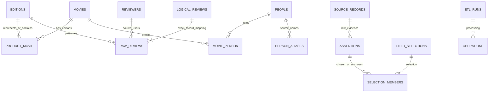

# Amazon 电影评论与元数据整合项目报告

数据存储与管理课程项目

报告更新日期 2026 年 10 月 19 日

## 摘要与验收结论

本项目以 Stanford SNAP Amazon 电影评论为主输入，构建流式抽取、合规元数据获取、内容分类、作品与人物匹配、上映年补全、字段选择、评论清洗和字段血缘的可重复运行流程。实现采用参数化 Python DAG 与 SQLite 关系数据库，原始输入、结构化分片、集成检查点和目标库分层保存。

全量处理保留 7,911,684 条原始评论、253,059 个商品和 889,176 个来源用户。5,146 条同商品下完全相同的原始记录建立重复映射，形成 7,906,538 条逻辑评论；原始删除数为 0。公开研究元数据覆盖 73,813 个商品，取得 5 组多字段支持的跨版本合并，282 条作品记录取得外部身份支持的上映年。最终 v8 包含 3,245 条人物记录、3,923 条角色信用及 5 组有独立作品上下文支持的实质别名；不能确认或明显非人物的姓名片段不创建人物。

工程核验与课程严格验收必须分开。五组正式跨版本合并已通过版本化下游重算、真实目标映射与工程复现。本次按用户指定范围交付来源证据标注：电影和人物各120对，187对确定、53对证据不足弃判，不包含人工姓名或标注时间。电影、人物独立人工标签仍各为0，独立准确率仍为NULL，因此不能宣称原课程所有条件全部通过。[最终交付说明](../docs/最终交付说明.md)说明本轮交付范围，[原课程要求审计](final/requirements_audit.json)保留对应差异，不以程序测试或来源一致性代替人工准确率。

## 一 项目目标与实施范围

评论文件中的 product/productId 是商品 ASIN，不是电影作品 ID。一个作品可能有多个介质、语言、字幕或区域版本，一个商品也可能是合集、剧集或非电影。本项目将商品、作品、评论、来源用户和演职人员分开建模，保留原始评论及来源差异，不把同标题条目直接当成同一作品。

实施范围为完整评论文件和由其产生的全量 ASIN 清单。网页获取仅在访问条件允许时进行；访问失败、未采集、元数据缺失、待确认和拒绝合并都是明确状态。少量离线样本只用于复现演示，不代替全量统计。本轮来源证据标注不声称完成人工争议裁定或独立人工验收，现场口述理解仍需实际参与者完成。

## 二 数据来源与证据登记

| 来源 | 实际使用范围 | 主要证据与限制 |
| --- | --- | --- |
| Stanford SNAP 评论 | 完整 movies.txt | 9,332,887,470 字节，原始 SHA-256 已登记；压缩原件实测哈希及准确下载时刻未登记 |
| Amazon 商品页面 | 全量清单及访问策略证据 | robots 预检连续 503；商品 HTTP 请求 0，成功 HTML 0，不绕过限制 |
| UCSD Amazon 2018 研究元数据 | 完整 gzip 扫描后按目标 ASIN 筛选 | 203,766 条实际 JSON 记录；88,660 条匹配记录，覆盖 73,813 个 ASIN |
| IMDb 官方非商业批量档案 | 标题、导演、主要演职员与姓名候选 | 四个文件单独登记 SHA、ETag、Last-Modified、run-date；年份不是完整日期，principals 不是完整 cast |
| Wikidata 官方查询接口 | 尝试补充人物别名 | 访问策略不允许声明身份发出查询，别名新增 0；未更换身份规避 |

原始评论 SHA-256 为 `ac12efcd30fecd0ff1ff27d16a48cd3354038331a9f812556f873c4fbe5895bc`。来源时间未知时为 NULL，观察文件的时刻不冒充下载时刻。UCSD 页面标称产品数 203,970 与档案实际记录数不同，目前没有足够依据解释该差异，未强行补齐或删除记录。

IMDb 四份 gzip 合计 1,410,525,652 字节，完整流式扫描至 EOF 并核验 CRC。新版标题候选筛选保留 13,828 个条目、108,402 个相关姓名、152,313 条主要演职员记录及 288,371 条原始定位记录；固定包重放还逐字段重提取核对保留 TSV。候选标题相同不等于身份匹配成功。此次离线重算复核原始登记的 URL、大小和 SHA，不创建网络客户端、不伪造新下载。各档案发布版本不同，不能把下载日当作统一快照日期。

来源依据为 [SNAP 官方说明](https://snap.stanford.edu/data/web-Movies.html)、[UCSD 数据说明](https://cseweb.ucsd.edu/~jmcauley/datasets/amazon_v2/)及 [IMDb 官方数据字段说明](https://data.imdb.com/non-commercial-datasets/)。IMDb 内容按其[使用条件](https://help.imdb.com/article/imdb/general-information/can-i-use-imdb-data-in-my-software/G5JTRESSHJBBHTGX)用于本地个人非商业课程实验，不向公开 Git 重发布原始或派生数据库。Information courtesy of IMDb (https://www.imdb.com). Used with permission.

## 三 流程架构与关系模型

原始层保存评论文件、研究压缩原件、访问失败快照和来源登记。结构化层保存分批评论、全量商品清单和元数据记录。集成层执行内容分类、作品与人物匹配、日期语义和字段选择。目标层保存实体、关系、原始评论、候选、决定及可查询血缘。

作业由 `config/pipeline.example.json` 定义，编排器验证依赖无环、参数和脚本路径，记录开始/结束、退出码、日志与定义哈希。失败阻断下游，不自动修改阈值或访问策略。数据阶段自行检查不可变输入指纹，并以事务批次或完成阶段恢复，不靠统计文件猜测游标。

Movie 与 ProductEdition 通过 ProductMovie 分离；关系允许 single_work 和 contains。合集没有可靠成员证据时不建立猜测映射，评论仅归属原商品。MoviePerson 区分 director、starring、cast，同一人可有多个角色；原始信用与排序另保留。类型使用可查询成员关系，地区、日期精度与上映类型单独保存。具体键、约束、索引及实际表结构见[数据字典](final/data_dictionary.json)与 [ER 源文件](../docs/schema.mmd)。

## 四 任务一至三 抽取与分类

### 任务一 全量流式抽取

解析器按字段前缀和确认的记录边界工作，不把正文中的空行或冒号当成记录结束。source_review_id 使用原始文件 SHA-256 与记录序号生成；每条记录保留字节、行定位和原始记录哈希。按 25,000 条事务批次输出 317 个 Parquet 分片，中断后检查已提交分片哈希再继续。

数量核对为 7,911,684 读取记录 = 7,911,684 有效记录 + 0 隔离记录。62,085 条有非 UTF-8 字节，受影响文本留空、原始字节保留并标记，不以 Latin-1 猜测事实；43 条 helpfulness 分子超过分母，46 条有多行字段。原件始终保留。任务一解析实测峰值约 322 MB，不代表后续数据库阶段的内存需求。

### 任务二 全量清单与合规获取

由完整评论构建 253,059 个 ASIN 的持久化清单，保存原始链接、评论数、首个评论 ID、来源版本和获取状态。网页采集采用单 worker、3 秒间隔、有限重试、TLS 校验、robots 与身份一致性检查，限制页面不计为成功。

本次 robots 失败后没有发送商品页面请求。替代研究档案通过原始 gzip、校验值、记录序号和解压偏移登记，按 ASIN 精确匹配，重复候选不静默覆盖。覆盖率为 73,813 / 253,059 = 29.17%；其余 179,246 个 ASIN 没有该来源元数据。6 条记录的内层 ASIN 涉及 4 个目标商品的身份冲突，保留原件并标记待确认，不支持自动作品合并。

### 任务三 内容分类

分类使用明确题名、类别和描述佐证，输出 movie、non_movie、compilation、television_series、concert、other_content、awaiting_confirmation。通用类别和缺少证据不能直接当成影片事实。所有原始 ASIN 均保留状态，未把无法分类的商品删除。

| 分类 | 商品数 |
| --- | ---: |
| movie 来源规则结果 | 3,617 |
| non_movie | 2,232 |
| compilation | 137 |
| television_series | 1,143 |
| concert | 308 |
| other_content | 7 |
| awaiting_confirmation | 245,615 |

本轮发现旧规则会漏掉“两个商品均待确认、但有充分电影叙事证据”的候选。v3 在排除剧集、教学、演唱会等相反语境后，补充与主标题紧密绑定的长电影叙事，或长叙事加多名明确主演佐证，新增 662 个 movie 规则结果；没有因为 VHS/DVD 标记或通用类别就视为电影。任务四的多字段合并阈值不降低。

全部 88,660 条候选及原始字段、253,059 个最终分类被程序重放。上述是规则输出，不是人工核实的内容准确率；研究类别可能包含教学或节目条目，后续单例作品保持临时身份，不能当作真实电影普查结果。

## 五 任务四与五 实体匹配

### 任务四 同一创作作品与商品版本

同一作品可跨介质、语言、字幕或区域商品；续集、翻拍和无关同名影片分开。剪辑、修复、未分级或时长差异按明确策略进入复核，不默认合并。标题规范化仅清理明确版本标记，保留真正副标题、数字与续集信息。

候选由精确标题/别名及受控近似阻塞生成。自动规则要求多字段组合，例如标题、明确导演及两名主演，或者影片语境年份与导演/两名主演；一致长描述仍需导演或多个演员上下文支持。标题、年份、缺失年份、未经核实的外部 ID 均不能单独支持自动合并。罗马/阿拉伯编号等价；一方省略编号时不直接判不同作品。

并组使用 complete-link：每次合并前检查所有交叉对，缺边不假定成立，避免 A-B、B-C 支持而 A-C 冲突的传递错误。保存候选决定、版本、组内检查及成员变化事件。电影 ID 是源记录锚定的系统 UUID，不直接使用 ASIN；同版本同输入稳定，规则/来源变化使用新目录并保留旧映射。

全量 552 个候选对中自动 5、待复核 479、拒绝 68。3,617 个电影商品种子形成 3,613 条作品记录，另挂接 1 个原待确认商品，ProductMovie 共 3,618 行：其中一组挂接的是原待确认商品，因此五组合并减少四个种子作品记录。3,608 条临时单例不证明其与所有其他作品都不同。

| 实际作品组 | 商品 ASIN | 本轮状态 |
| --- | --- | --- |
| Star Trek VI - The Undiscovered Country | 630242335X / 6305252599 | 原有组重放 |
| Lady for a Day | B006QS9M1S / B006QS9MC2 | 原有组重放 |
| Chocolate | B001EBO90G / B001L67A3M | 原有组重放 |
| The Big Lebowski | 6304994540 / 6304994567 | 新增正式组 |
| The Other Boleyn Girl | B0012QE4Q2 / B0017APPSE | 新增正式组 |

新增 Big Lebowski 具有相同长剧情及多名演员上下文，原题名均标 VHS，不臆造 DVD 或已验证音轨。Other Boleyn Girl 具有相同长剧情、多名演员及原件中 DVD/Blu-ray 的交叉商品链接。每组所有成员对重新比较，实际簇及目标映射均核对；这些开发演示与保留评估对无重叠，见[五组来源验收](task4/five_group_acceptance.json)。

同时发现 Godkiller 两商品分别是约 25 分钟的分集发行与约 82 分钟完整长片；新增 `episodic_installment_not_complete_feature` 拒绝规则，即使标题/演员相同也不合并。该旧提案未加载，不用于达到五组。五对保留分离的真实续集例来自三个系列，不把教学或电视剧分卷冒充电影。达到五组来源案例要求不等于完成独立人工准确率评估。

### 任务五 人物身份与角色

先对作品进行独立的多字段外部匹配，再依据同一作品、角色、完整姓名和唯一外部信用绑定人物。全部 14,211 个作品候选保留；282 条作品记录获唯一多字段支持，3,330 条未解决、1 条有歧义。姓名相同或首字母相同不直接跨作品合并。

已支持人物 ID 锚定 nconst；未支持的明确姓名按来源上下文建临时记录。保留来源拼写、比较用规范名、外部 ID、别名及角色。IMDb actor/actress 类 principals 仅是主要 cast，不是完整演员表，不能按前三名推断主演。导演、明确主演、cast 分开保存；来源有排序才保留，未知为 NULL。

自查修正了上游 credited_stars/credited_cast 的衔接，并从完整原件恢复被片段截断的姓名。进一步复查发现完全相同规范名的限制漏掉了中间名或附加姓氏；多个 principal 信用中的同一个 nconst 也被误当成多个身份。v4 人物规则仅在作品已由精确姓名等独立多字段匹配、角色对应且外部人物唯一时接受结构性姓名变体，不用模糊编辑距离或首字母单独确定身份。冲突中间名、多个可信人物仍待确认。

46 条无法确认或包含奖项、音轨格式、说明文字的片段只留决定，不建立人物。最终人物 3,245：外部上下文支持 2,706、临时 539；信用 3,923：director 521、starring 572、cast 2,830；别名记录 3,910。全部 864 条明确角色候选保留决定。临时人物仍可能包含来源表达歧义，不将姓名形态检查当作人工事实核实。

五对同规范名、不同外部 ID/出生年/信用上下文的分离例保存在候选档案中，不全属于最终加载人物，也不是人工金标准。此次用现有 UCSD 原件和官方外部信用取得 5 个不同人物的实质别名组，涉及 7 条原始别名断言；不是大小写、标点或空白差异凑数。每组保存原始姓名定位、作品匹配、唯一人物候选和外部信用，实际证据包见[别名审计](task5/substantive_alias_audit.json)中的本地路径与哈希。Wikidata 别名查询仍为 0，没有因结果不足而绕过访问策略。

## 六 任务六与七 日期与字段选择

### 任务六 上映语义

仅在作品匹配成功后采用 IMDb startYear 的上映年语义。282 条有年份，完整日期为 NULL，精度为 year，地区未知；不能称为全球最早首映日。其余 3,331 条保留身份未验证等缺失原因。不把年份补成 1 月 1 日，也不把商品发行时间与作品上映时间比较。

评论可能是预售、版本或合集评论，本次没有足够条件声明作品上映上界。因此推断上界也是 NULL。任务九新增 work_review_observations，按 single_work 映射取最早有效评论时间，保留贡献评论 ID、原值、文件哈希、记录序号、字节定位和规则；它是独立观察，不替代上映信息。未输出推断值，不存在需要伪造的推断日期或贡献评论集合。

### 任务七 候选与选择

先检查语义及适用身份，再为标量选择唯一的适用权威值；同等权威冲突保持 NULL/unresolved，不按最后采集或多数投票硬选。多值明确取并集，每个成员保留自己的断言与来源。导演、主演、cast 不混成一个名单。

外部已匹配工作题名优先；未匹配作品的商品题名仅是临时显示标签。来源年份提示保留为身份候选，不直接成为上映值。类型名称统一为受控键，如 Sci-Fi→science_fiction，原始值仍保留；语言只采用受支持别名，未知不猜测。

v8 集成阶段有 1,800,317 个选择状态：selected 165,642、missing 1,634,675、unresolved 0，关联成员 290,246。字段增长来自实际新增作品及来源证据，不以填满字段为目标。本次没有同等权威最终值冲突，不虚构真实冲突数量；合成测试覆盖冲突时返回 NULL。全量非缺失字段、候选采用状态及原件哈希均重放通过。

## 七 任务八 评论与统计口径

原始字段和清洗文本分别保存。清洗仅做 HTML 实体、Unicode NFKC 和空白规范化；无法解码的字段仍为 NULL，原始字节和质量标志保留。评分和时间检查保留原值及异常，不把异常记录删除。

仅同 ASIN 下完整原始记录字节相同才共享逻辑评论 ID，命中后再核对全部关键字段；相似正文、同一用户或跨商品重复不自动去重。5,146 条建立重复映射，全部 7,911,684 条原始记录仍可查询。0/0 helpfulness 比率为 NULL，只有分母大于零且票数范围正确才计算。

评分分母是一条有效分数对应一条逻辑评论，不是人数、原始重复数、演员行数或元数据行数。合集仅在商品级统计，single_work 版本才进入作品聚合；跨版本疑似重复仍保留、另列待复核。作品聚合同时显示身份状态、原始数、逻辑数和有效分数分母，临时作品不能当作已确认电影的评分榜。

独立检查逐条比较了全部原始字段、清洗值及逻辑 ID，317 个分片哈希通过，外键与逻辑代表错误为 0。身份映射 SHA-256 为 `8eb65b283e4265eb6edad92ba4d771257d81f7c125f580599e1f1eca7ba922f2`，重复运行一致。评论 SQLite 为 26,780,393,472 字节，物理 SHA、位置与重建步骤见[输出登记](task8/output_manifest.json)。

## 八 任务九 字段血缘与目标加载

SourceRecord 保存数据文件版本、记录序号、字节定位、原始哈希/内容、URL 和采集时间。FieldAssertion 保存原始与规范值、字段定位、规则、实体和运行。FieldSelection 与 SelectionMember 保存最终值、采用及未采用证据和选择理由。处理图连接原件、断言、匹配输入、操作及最终选择，操作时间以相应运行时间登记，不伪造逐字段精确瞬时戳。

外部身份候选包括未采用条目，其题名、crew、主要演员及姓名输入仍可反查影响。派生 ID、匹配状态和日期精度另记录规则语义，不把处理状态当成来源事实。商品没有元数据时，真实评论仍提供 ASIN 与处理定位锚。

评论以可查询的 review_field_lineage 视图保存字段前缀、原/规范列、原始文件 SHA、字节/行位置、抽取与清洗规则/运行及父链，避免物化约八千万条相同的字段规则。原件保存在 raw 层，普通 UTF-8 评论通过定位回看，异常字节另存 Base64。多值类型与角色保留成员级来源，不只有 movie-to-URL 映射。

加载按一致性评论备份、事务集成、处理图、索引与候选阶段登记，全部完成后才原子发布。相同输入重跑跳过已完成阶段，不增加实体或关系。来源/规则变化拒绝覆盖旧目录；源反查及 `impact_analysis.py` 定位候选影响，DAG 从相应步骤重算。本轮以 Task3 full_v3、Task4 full_v4、IMDb 候选目录 v2、final_v8 重算分类修正及其全部受影响下游，旧 v7 数据和重算前报告另存，不原地改映射。

本轮还实际遇到“目标库已原子发布、进程在写大文件哈希摘要前结束”的恢复窗口。正常 target_verify 新增登记指纹和 ready 状态检查，只对已发布目标恢复缺失摘要，记录真实观察时间，不冒充原始完成时刻；未完成目标或错误登记被拒绝。重跑 DAG 重新检查输入和阶段，旧未结束运行不被追写成成功。

最终目标的物理哈希、表数量、约束及查询核查见[加载统计](task9/load_statistics.json)、[全量核验](final/full_verification.json)、[查询执行](final/query_verification.json)。这些记录须以实际执行结果为准，不由报告推测生成。

全量最终目标为 `data/target/final_v8/etl.sqlite3`，35,099,467,776 字节，实际 SHA-256 见加载统计。保存 377,031 条来源记录、1,419,863 条字段断言、2,846,475 个最终选择状态、1,336,404 条成员关系和 7,876,297 条处理边。目标选择状态含派生标识与状态，因此数量不同于任务七的元数据选择数。全量外键错误、商品评论数不一致、未知父节点、选用字段缺来源、非法 helpfulness 比率均为 0。旧集成库和目标库保留，不原地覆盖。

本轮对原始评论、目标、评论库、商品清单、研究元数据及两项固定包输入共7个登记成果实际重新计算SHA并匹配，见[大文件核验](final/large_artifact_verification.json)。该实际核验时间与之后的提交清单刷新时间分开保存。

来源影响演示实际从一条 IMDb 原件定位到 1 个实体的 12 个字段，并给出任务五、六、七、九的重算范围；这是依赖影响，不表示这 12 个值必然改变。未采用的身份候选也参与反查。列名 canonical_title 与语义字段 title 等映射单独登记，避免界面列名与血缘字段名不一致。

字段完整性按要求使用 282 条独立多字段已识别作品作为电影信息分母，而非把全部临时单例混入：题名、类型、导演、上映年与时长均 282/282，部分 cast 为 281/282，明确主演为 96/282，完整日期为 0。该条件覆盖率不表示全量识别充分；全体 253,059 商品中，286 个映射到这些作品，识别覆盖为 0.113%。另外保留全部 3,613 条作品记录的分母口径，避免隐藏未解决条目。商品题名覆盖 29.17%、介质 6.45%、语言 20.53%、字幕 6.56%；地区、分销商及商品发行日期没有支持值。有部分 cast 不代表演员表完整，详见[字段完整性](final/field_completeness.json)。

## 九 质量评估与复现证据

### 程序检查与人工评估

工程测试覆盖原有抽取、合规、匹配、血缘与人工包校验，以及主标题绑定长叙事、分集/长片冲突、显式离线档案分支、真实失败原件包校验、原子发布后的摘要恢复和隔离路径/联网阻断。来源标注和交付封装另覆盖字段移除、证据哈希、弃判、禁止覆盖、来源对照及归档成员哈希等检查；当前完整测试数量与实测耗时见[工程测试报告](final/test_results.json)，不把合成测试当作实际来源标注。未提升 Scrapy 的历史测试已归档，不计入本次。全量原件、决定、成员与导出重放检查另存统计。最早评论观察另逐一核对最小有效源 Unix 时间、贡献评论和原始定位。

电影和人物各准备 120 对待标注候选。旧人物队列排除开发来源后只剩同一身份候选，不足以支持正负例评估，因此另建只读独立登记集：60 对跨作品、30 对相似姓名、30 对相同首字母候选。本轮 people_v3 排除已检查的 276 条开发来源及 5 个别名人物，annotation_v2 绑定当前模型。候选分层不是人工金标准类别，困难案例和正负类仍须由标注者确认。

实际人工完成数均为 0，Precision/Recall/F1 为 NULL，不能编造误合并/漏合并率。正式评估需要各至少 100 对、正负类齐全，并保存人工作者、含时区时间、证据、理由及争议解决。评分程序仅核验声明和计算指标，不能证明背后确为人工。新版人物队列路径及校验见[评估集登记](task5/evaluation_queue_audit.json)。本轮另导出各120对的盲化人工包，移除原人物注册队列中模型绑定的外部ID、身份状态、生卒年及模型分层，避免标注者直接看到预测结果。评估器支持多人人工判断和争议裁定、人工处理覆盖率及误合并/漏合并明细；空标签按设计拒绝计算。操作与局限见[人工评估说明](../docs/人工评估与剩余验收.md)，交接指纹见[标注包登记](final/human_evaluation_handoff.json)。

工作队列与人工完成覆盖分开报告：作品候选待复核 479/552，人工完成覆盖 0；外部作品未唯一匹配 3,331/3,613（含 1 条歧义）。人物决定、未建人物片段及临时人物数量单列，不称为人物准确率。零分母指标为 NULL，不当作满分。

最终来源证据标注位于本机 source_annotations_v1，不要求继续填写人工身份。电影同一14、不同57、证据不足49；人物同一59、不同57、证据不足4。标签、具体理由、左右上下文和原始证据引用保留，标注人、标注时间及签认字段均不纳入最终模式。523个原始记录引用的字节SHA、每对上下文及正式文件登记已核验，原盲化包和生产库不被覆盖；人物第090对的参照片出演者抽取风险保持弃判。见[标注登记](final/source_annotations.json)及[完整性核验](final/source_annotation_verification.json)。

另对固定final_v8作只读诊断对照。电影71对确定来源判断中64对缺少双方唯一single_work映射，明确计为模型未映射/不适用而不当作真负例；仅比较7对，均为不同作品，Precision/Recall/F1分母不成立，均为NULL。人物116对可比较，TP57、FP0、FN2、TN57，来源参考一致性Precision1.0、Recall0.9661、F10.9828，涉及9个临时身份侧。来源人物号、重复原件及信用与系统有重叠，故该一致性不是独立人工准确率，不能外推全量。详见[来源一致性诊断](final/source_annotation_agreement.json)。

### 中断与幂等

任务八实际在 25,000 条后中断，并在性能调整时从 1,500,000 条已提交游标恢复至下一批 1,525,000；最终全序列比较没有跳过或重复。重复运行原始数、逻辑数及完整身份映射哈希一致，只有审计运行新增。任务四、五、六、七的同输入结果哈希也分别核对。

历史 v7 全量目标曾实际在 review_copy 后主动停止并观察退出 130；该历史证据不冒充当前 v8 的主动中断。本次 v8 受影响的 15 个 DAG 作业完成，实际目标重跑返回 `already_complete_no_insert`，前后全部 15 类业务数量一致；任务五、六、七的有序表哈希分别比较。当前固定样本另真实执行 integration 后退出 130、恢复和重复，证据见[任务九幂等](task9/idempotency_recovery.json)和[固定样本恢复](final/offline_recovery.json)。

[当前流水线验收](final/movie_merge_pipeline_acceptance.json)另外直接查询最终目标的5个跨商品作品组及新增两对single_work关系；全量与固定样本均实际达到5组。该验收不写人工标签，也不把提案计入已加载组。

新版固定离线包 fixed_v3 含 28 条原始评论、31 条研究原件，重建 15 条作品记录、122 人物、169 信用、1,220 字段状态与 7,741 处理边，包含五组电影合并和五组实质别名。另覆盖非电影、合集、缺失日期及内层 ASIN 冲突；不将演示作为独立人工评估。失败分支包含真实 robots 503 字节、哈希和逐商品零请求状态，重放时验证，不仅在清单里写“覆盖失败”。哈希见[固定样本登记](final/offline_sample_manifest.json)；样本每商品仅一条评论，不用它代替全量评论去重核验。

隔离复现另建代码/配置/SQL/报告副本，从固定包及候选档案的空输出重建。Python审计钩子检查文件/数据库连接并阻断 DNS 和联网，SQLite authorizer另检查ATTACH路径；当前v4实测13个数据库连接、3次ATTACH，结果数量一致、十个查询通过、网络0。这不是操作系统安全沙箱；只共享已安装 Python 依赖，不声称独立环境安装、第二台机器或全量重建，见[隔离复现证据](final/isolated_reproduction.json)。

### 结果查询

[十个可执行 SQL](../sql/demo_queries.sql)覆盖：作品版本；导演作品及原件；缺失/推断上映信息；冲突、全部候选与理由；评论数及评分分母；指定电影字段追溯；ASIN/评论到作品与状态；原始源记录到受影响最终字段；人物原始信用、别名决定和关联作品；最早评论观察及贡献原件。无参数时只展示少量行，指定实体时不再截断为前 30 行。查询只读；受限来源的具体返回行留在本机，不放入公开 Git。

十个查询已在全量目标实际执行通过，不只在小样本验证。作品评分聚合先限定 single_work 相关商品，再按原有逻辑代表口径聚合；合成测试核对原始数、逻辑数、有效分母与均值。跨版本相似评论现有 1,008 对待复核，未自动删除，因此评分仍可能含同一用户跨版本重复意见，不宣称得到跨版本完全去重的意见集合。

## 十 环境 重建与交付

环境为 Windows PowerShell、Python 3.11.9、固定版本 pyarrow/psutil/protego/truststore 与标准库 SQLite。解析采用 25,000 条批次；后续数据库缓存在有界范围内配置。实测评论写入/重复阶段观察峰值约 1.46/1.85 GB，只读全量核验观察约 2.36 GB，不能沿用任务一内存值估计完整流程。建议至少 8 GB 内存及 120 GB 可用磁盘，保留历史版本需更多空间。

按 [README](../README.md)安装固定依赖、恢复允许使用的原件、核对 SHA 并登记本机路径。重新解析后应从真实检查点导出当前分片清单；新 run_id 可改变 Parquet 和 SQLite 物理哈希，同来源/规则的稳定 ID、语义映射及数量另行比较。官方档案持续刷新，丢失历史原件后不能承诺公开地址仍返回相同字节。

Git 提交代码、作业定义、配置模板、模型/SQL、报告及小型统计/检查/恢复证据，不提交凭据、环境、大型数据、受限原件或派生数据库。原始/目标数据位置、哈希和重建说明作为交付证据；克隆仓库并不自动得到数据本体。所有任务的实际版本修正和推送过程统一见[实施记录](../项目实施记录.md)。

本次正式报告采用 Markdown。原 Word 草稿未覆盖，现与指导文档移到项目外归档；文档渲染诊断因缺少 soffice.exe 未通过，因此不交付未经逐页核验的 Word。清理保留了当前原件、检查点、最终目标和离线样本；大型数据不公开上传，按[交付与恢复说明](../docs/交付与恢复.md)提供校验、位置和重建步骤。

## 十一 分工 AI 使用与交付边界

用户完成原件下载解压、确认存储格式和异常处理原则，并授权逐任务检查与 Git 推送；本轮明确选择来源证据标注、不要求填写人工姓名或时间。Codex 辅助编程、运行、程序核验、源证据检查、来源标注和文档整理。标注的事实依据是已保留原件，不能由助手生成的文字替代原始来源；未把来源标注或诊断一致性称为独立人工标签或独立准确率。其他成员及实际人工裁定记录未提供，不虚构贡献。

五组正式跨版本合并的缺口已经关闭。本轮交付范围不再以人工填报为门禁，但原课程严格验收仍要求电影与人物各至少100对独立人工标签及实际争议记录；已有同名不同人来源例的最终目标适用范围仍受限，缺失的历史下载证据保持未知。补充检索实际检查2,352个有外部候选的合格商品（其中未映射307个），301个具备独立匹配证据；仅一个未加载提案且内容范围不兼容，安全提案为0，不将这些线索计入五组，见[检索证据](task4/external_edition_search.json)。覆盖率、临时身份、分类误判风险和来源限制继续披露；工程可复现及可封装交付不等于事实全部正确或课程严格验收全部通过。

Scrapy真实复试中，初次证书失败经系统可信根适配后取得3次503；用户关闭VPN、确认WLAN路由后，单次同身份Scrapy预检仍为503，不能归因为VPN单一因素。未发出商品请求、HTML成功仍为0，未替换正式采集器。失败试验的代码与原始证据现移到项目外归档，提交保留[复试汇总及证据哈希](task2/scrapy_retest_summary.json)，不把试验程序计为已投入最终DAG的采集器。
